# Linkly - URL Shortener with Analytics

A fully functional URL shortener built with **Node.js, Express 5, and PostgreSQL**. Users can turn long URLs into short codes (or choose vanity codes), redirect visitors with correct HTTP semantics (302/404/410), track every click with an atomic counter that never loses updates under concurrency, and export click logs as CSV. Fully documented with an OpenAPI 3.1 spec served via Swagger UI.

---

## 🎯 Project Goals

This project aims to:

- Build a **REST API** with correct HTTP semantics (400/404/409/410/429)
- Implement an **click counter**
- Use **PostgreSQL** with real constraints (`UNIQUE`, `CHECK`, `FK ON DELETE CASCADE`)
- Validate every input with **Zod**
- Implement **pagination** with cursors for the click log
- Test everything with **`node:test`** against a disposable test database
- Document the API with **OpenAPI 3.0** + Swagger UI at `/docs`

---

## 🚀 Key Features

### Create Short Links

- `POST /links` with `{ target_url, code?, expires_at? }`
- Returns **201 Created** with  `created_at`, `click_count: 0`
- **Vanity codes** accepted if they match `^[A-Za-z0-9_-]{3,16}$`
- **Random base64 codes** generated automatically if omitted
- Duplicate codes rejected with **409 Conflict**
- Invalid URLs / malformed codes rejected with **400 Bad Request**

### Redirect with Correct Semantics

- `GET /:code` returns **302 Found** with `Location` header while the link is live
- **404 Not Found** for unknown codes
- **410 Gone** for expired links (checked at read time, never cached)
- **`click_count` incremented** in the same transaction as the click log insert
- **User_Agent and Referer** captured per click

### Click Counter

- **Single-statement SQL**

  ```sql
  UPDATE links SET click_count = click_count + 1 WHERE id = $1
  ```

- The increment and the `INSERT INTO clicks` share **one transaction**

### Click Log with Keyset Pagination

- `GET /links/:code/clicks?after=&limit=` returns `{ data, next_cursor }`
- Uses `id < $2 ORDER BY id DESC LIMIT $3` - **no OFFSET**
- Cursor is the last seen click ID; `null` means no more pages
- `limit` is bounded by Zod (`1..100`, default `20`)

### CSV Export

- `GET /links/:code/clicks.csv` streams the full log
- `Content-Type: text/csv` + `Content-Disposition: attachment`
- Exports click history as CSV.
- Manual field escaping: quotes, commas, newlines handled

### 🗑️ Delete with Cascade

- `DELETE /links/:code` returns **204 No Content**
- Click log rows removed automatically by `ON DELETE CASCADE`
- **404** for unknown codes - nothing else happens

### Input Validation with Zod

- `target_url` must be a valid **http(s)** URL - `javascript:`, `data:`, `file:` rejected
- `code` must match `^[A-Za-z0-9_-]{3,16}$`
- `expires_at` must be a valid ISO 8601 date-time

### OpenAPI 3.0 + Swagger UI

- Complete spec at `src/docs/swagger/js` covering all 7 endpoints
- Served interactively at **`GET /api-docs`**
- **Try it out** button works from the browser

### 💚 Health Check

- `GET /health` runs `SELECT 1` against the database
- **200** `{ status: "ok" }` when live
- **503** when the DB is unreachable

---

## 🛠 Tech Stack

### Languages & Frameworks

- **Node.js 20+** (ESM)
- **Express 5**
- **PostgreSQL 16**
- **Zod 4**

### Libraries

- **pg** - PostgreSQL driver with connection pooling
- **swagger-ui-express** - interactive API documentation
- **dotenv** - env loading

### Dev Tools

- **node:test** - built-in test runner
- **supertest** - HTTP assertions for contract tests
- **ESLint 9**

---

## Design Decisions

### Transactions

A redirect performs two operations:

1. Insert click log
2. Increment click_count

Both operations run inside the same transaction so they either succeed together or fail together.

### Database Constraints

The database enforces:

- UNIQUE(code)
- CHECK(click_count >= 0)
- FK ON DELETE CASCADE

This prevents invalid data even if application bugs occur.

### Cursor Pagination

Click history uses keyset pagination with a cursor (`after`) instead of OFFSET because it scales better on large datasets.

## 📐 Database Schema

```sql
CREATE TABLE links (
    id SERIAL PRIMARY KEY,
    code VARCHAR(16) UNIQUE NOT NULL,
    target_url TEXT NOT NULL,
    created_at TIMESTAMPTZ NOT NULL DEFAULT now(),
    expires_at TIMESTAMPTZ,
    click_count INTEGER NOT NULL DEFAULT 0 CHECK (click_count >= 0)
);

CREATE TABLE clicks (
    id SERIAL PRIMARY KEY,
    link_id INTEGER NOT NULL REFERENCES links(id) ON DELETE CASCADE,
    clicked_at TIMESTAMPTZ NOT NULL DEFAULT now(),
    referrer TEXT,
    user_agent TEXT
);

-- Indexes for the click log and keyset pagination
CREATE INDEX clicks_link_id_clicked_at_idx ON clicks (link_id, clicked_at);
CREATE INDEX clicks_link_id_id_desc_idx ON clicks (link_id, id DESC);
```

The `UNIQUE(code)` constraint provides the index used by every redirect lookup. Verified with `EXPLAIN`:

```bash
psql "$DATABASE_URL" -c "EXPLAIN SELECT id FROM links WHERE code = 'demo';"
# point to index scan using links_code_key on links
```

---

## 📁 Project Structure

```text
url-shortener/
├── .github/
│   └── workflows/
│       └── lint.yml
├── scripts/
│   └── migrate.js
├── sql/
│   └── migrations/
|   |       |── 01_creat_links.sql
|   |       └── 02_create_clicks.sql
│   └── schema.sql
├── src/
│   ├── app.js
│   ├── controllers/
│   │   └── linkController.js
│   ├── db/
│   │   └── env.js
│   │   └── pool.js
│   │   └── query.js
│   │   └── testConnection.js
│   │   └── transaction.js
│   ├── docs/
│   │   └── swagger.js
│   ├── errors/
│   │   ├── appError.js
│   │   ├── ConflictError.js
│   │   ├── GoneError.js
│   │   ├── NotFoundError.js
│   │   └── ValidationError.js
│   ├── middleware/
│   │   ├── errorHandle.js
│   │   └── notfound.js
│   ├── routes/
│   │   └── linkRoutes.js
│   ├── services/
│   │   └── linkService.js
│   ├── schemas/
│   │   ├── linkSchema.js
│   │   └── paginationSchema.js
│   └── utils/
│       ├── generator.js
│       └── logger.js
├── test/
│   ├── generateCode.test.js
│   ├── health.test.js
│   ├── links.test.js
│   └── linkSchema.test.js
├── .env
├── .env.example
├── .env.test
├── eslint.config.js
├── .gitignore
├── .nvmrc
├── package-log.json
├── package.json
├── README.md
└── server.js
```

---

## 🚀 Getting Started

### Prerequisites

- **Node.js** = 24.21.0
- **PostgreSQL** ≥ 15 running locally
- A database user with `CREATEDB` privilege

### Installation

```bash
# Clone the repository
git clone https://github.com/karl-Rollins/Linkly-url-shortener.git

# Move into the project directory
cd Linkly-url-shortener

# Install dependencies
npm install

# Create the databases
createdb url_shortener
createdb url_shortener_test

# Configure environment
cp .env.example .env
# Edit .env with your DATABASE_URL and TEST_DATABASE_URL

# Start the development server
npm run dev
```

The API is available at `http://localhost:3000`.
Swagger UI: <<http://localhost:3000/api-docs>>

### Useful Scripts

| Command | Description |
| --- | --- |
| `npm run dev` | Start server with `--watch` (auto-restart) |
| `npm start` | Start server |
| `npm test` | Run all tests against `url_shortener_test` |
| `npm run lint` | Run ESLint on `src/` and `test/` |

---

## 🌐 Live Demo

🔗 **Deployed on Render:** [https://linkly-url-shortener-hsqj.onrender.com](https://linkly-url-shortener-hsqj.onrender.com)

Swagger UI: [https://linkly-url-shortener-hsqj.onrender.com/api-docs](https://linkly-url-shortener-hsqj.onrender.com/api-docs)

> ⚠️ **Cold start** - the free Render tier sleeps after 15 minutes of inactivity. The first request may take 30-60 seconds. Ping `/health` two minutes before a demo to wake it.

---

## 📸 API in Action

Every endpoint, tested live. Each pair shows the **Try it out** panel from Swagger UI alongside the actual server response.

### Create a short link - `POST /links`

| Request (Swagger UI) | Response (201 Created) |
| :---: | :---: |
| 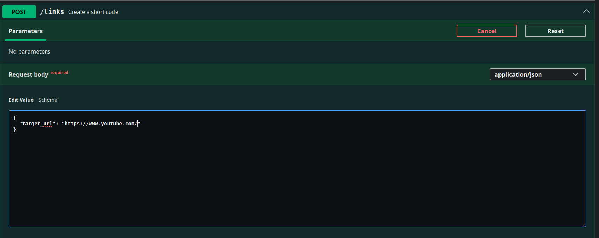 | 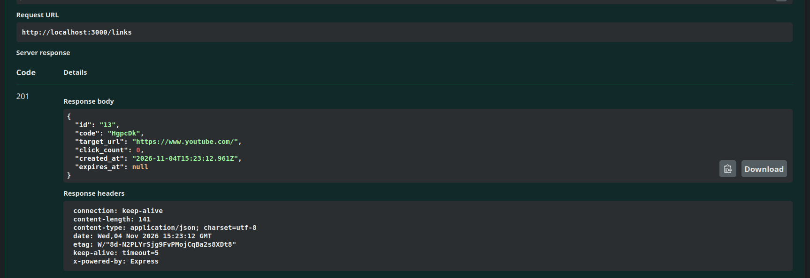 |

---

### Read link metadata - `GET /links/:code`

| Request (Swagger UI) | Response (200 OK) |
| :---: | :---: |
| 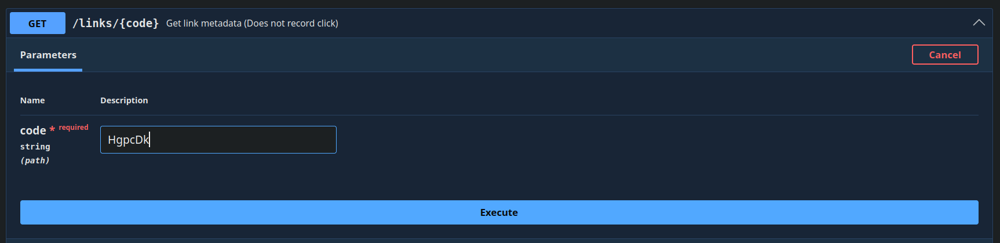 | 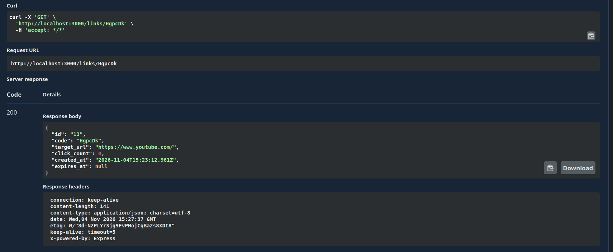 |

---

### Redirect - `GET /:code`

Swagger UI follows the target site

> Redirecting `http://localhost:3000/sino` → `https://sinosourcing.store/products/750117308591`

---

### Click log with keyset pagination - `GET /links/:code/clicks`

| Request (Swagger UI) | Response (200 OK with cursor) |
| :---: | :---: |
| 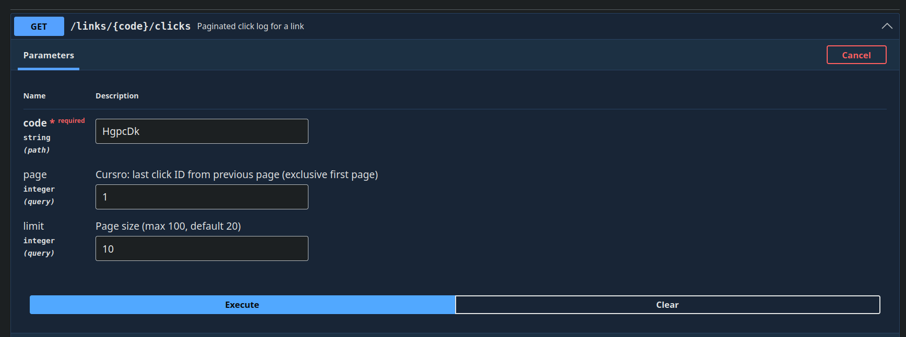 | 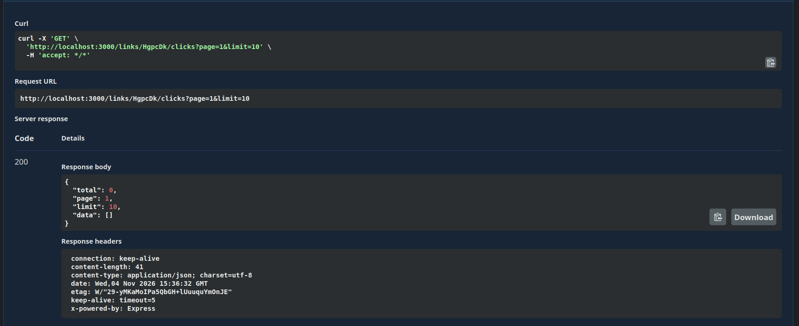 |

---

### CSV export — `GET /links/:code/clicks.csv`

| Request (Swagger UI) | Response (CSV stream) |
| :---: | :---: |
| 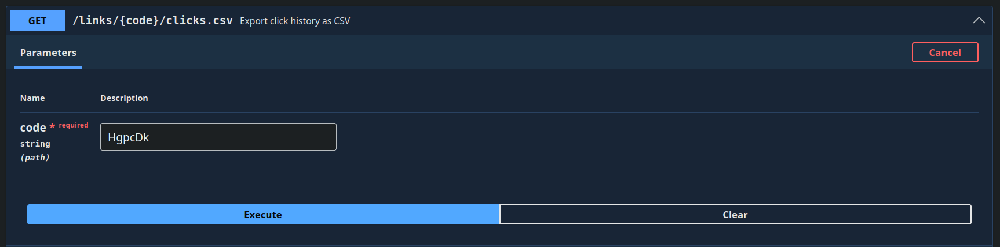 | 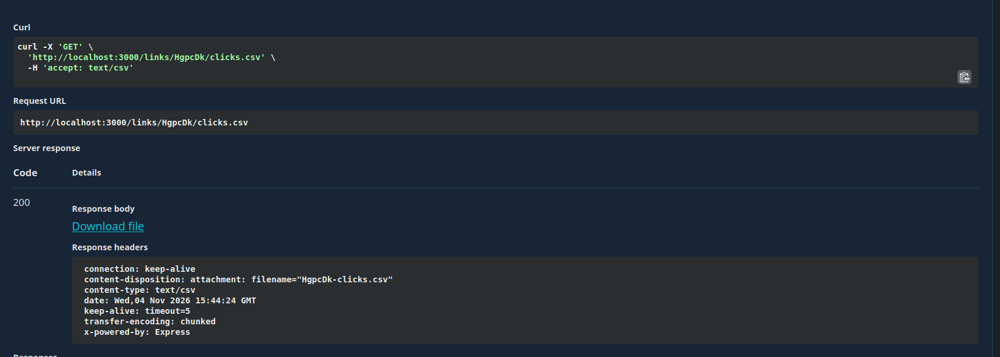 |

---

### 🛡️ Duplicate code rejected — `POST /links` with existing code

| Request (Swagger UI) | Response (409 Conflict) |
| :---: | :---: |
| 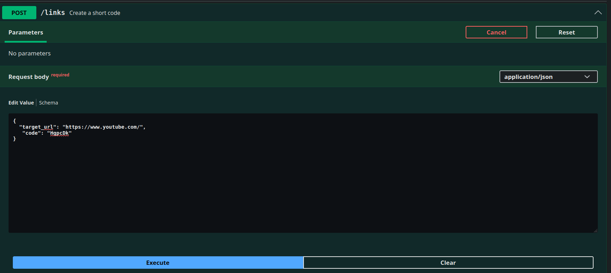 | 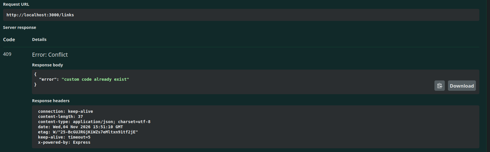 |

---

### 💚 Health check — `GET /health`

| Request (Swagger UI) and Response (200 OK) |
| :---: |
| 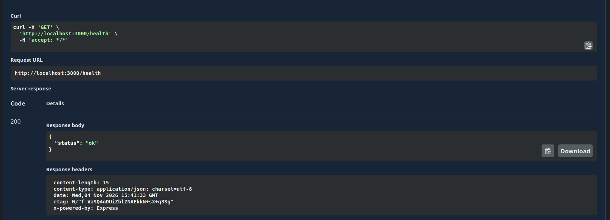 |

---

## 🧪 Testing

```bash
npm test
```

Runs `node:test` against `url_shortener_test`.

**18 tests** cover:

| Category | What's tested |
| --- | --- |
| Contract | 201/400/404/409/410/429 per endpoint |
| generateCode | genrates a string, max length 7 |
| Zod validation | URL schemes (`javascript:`, `data:`, `file:` rejected), code patterns, limits |
| Pagination | pages and limit, `OFFSET`, `total_pages, current_page, data: null` at end |
| CSV streaming | Header, rows, correct `Content-Type`/`Content-Disposition` |
| Cascade delete | No orphan clicks after `DELETE /links/:code` |

---

## 🧠 Challenges Faced

How to configure `lint.yml` to run every test with each commit.

**Solution**: added in  `eslint.config.js` the database information since it had no access to it on github

### 2. Counter Under Concurrency

The obvious approach (`SELECT click_count; UPDATE click_count = N + 1`) loses updates when two requests interleave. The brief required a single-statement atomic increment.

**Solution**: `UPDATE links SET click_count = click_count + 1 WHERE id = $1` inside a transaction with the `INSERT INTO clicks`. PostgreSQL serializes concurrent `UPDATE` on the same row. The 50-concurrent test proves it.

### 3. Removing docker file

`Docker` used port `5432` while databases used `5433` so when i removed the file it caused alot of issues since no database was created locally.

**Solution**: In the env files i changed port to the default 5432 and created the databases manually

### 4. Keyset Pagination with Correct Cursor Semantics

`OFFSET` degrades linearly with page count and can skip rows when new clicks arrive mid-pagination.

**Solution**: `WHERE id < $2 ORDER BY id DESC LIMIT $3`. Fetch `limit + 1` rows to detect the next page without a separate `COUNT(*)`. Return only `limit` rows plus `next_cursor`. No `OFFSET`, no performance cliff.

### 5. CSV Export and Data Escaping

Generating CSV files seemed straightforward until real-world data was introduced. Browser User-Agent strings and referrer URLs can contain commas and quotation marks, which break CSV parsing if fields are not escaped properly.

**Solution:** Implemented a dedicated CSV escaping helper that wraps fields in quotes and doubles embedded quotes according to the CSV specification. This ensured exported files open correctly in spreadsheet applications and CSV parsers.

---

## 📚 What I Learned

- Writing **single-statement SQL**
- setting up **Docker** with **PostgreSQL** though i had to take it down later.
- Implementing **pagination** correctly, `limit + 1`
- Using **`node:test`** with `--test-concurrency=1` to avoid DB conflicts between test files
- Structuring Zod schemas at the boundary
- Writing **OpenAPI 3.0** specs and validating them against
- **`TRUNCATE ... RESTART IDENTITY CASCADE`** for test isolation without re-creating the schema every run
- Debugging real production issues ( `--eslintrc` flag,)
- migration. How it works and implemented.
- Concurrent redirect test to verify atomic click counting under load
- Includes regression tests against malicious input and SQL injection attempts

---

## Stretch Goals (Not Implemented)

- **Top-referrers analytics** - `GROUP BY referrer` per link
- **QR-code generation** - `GET /links/:code/qr` returning a PNG
- **Expiry sweeper** - a background job that retires expired links proactively (currently handled at read time)
- **Distributed rate limiter** - Redis-backed for multi-instance deployments

---

## 🏽‍💻 Author

**NGANGSI Karl Alaindo**
Junior Fullstack Developer

📩 Email: [karlrollins25@email.com](mailto:karlrollins25@email.com)
🌍 Based in Cameroon | Open to remote opportunities
🔗 GitHub: [https://github.com/karl-Rollins](https://github.com/karl-Rollins)

---
